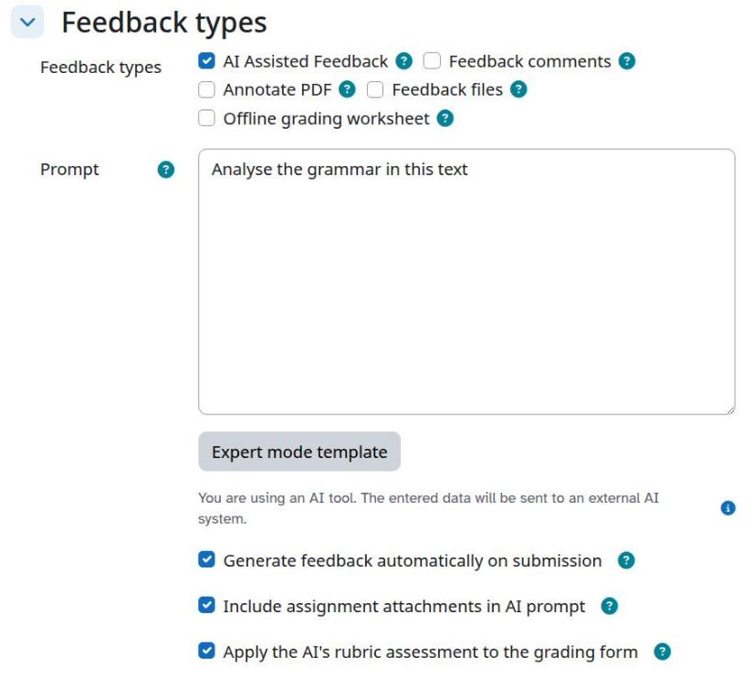
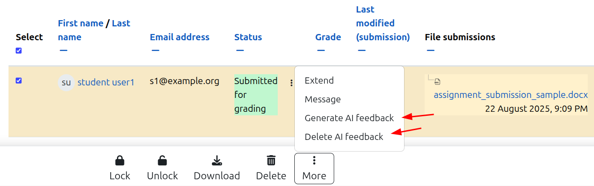
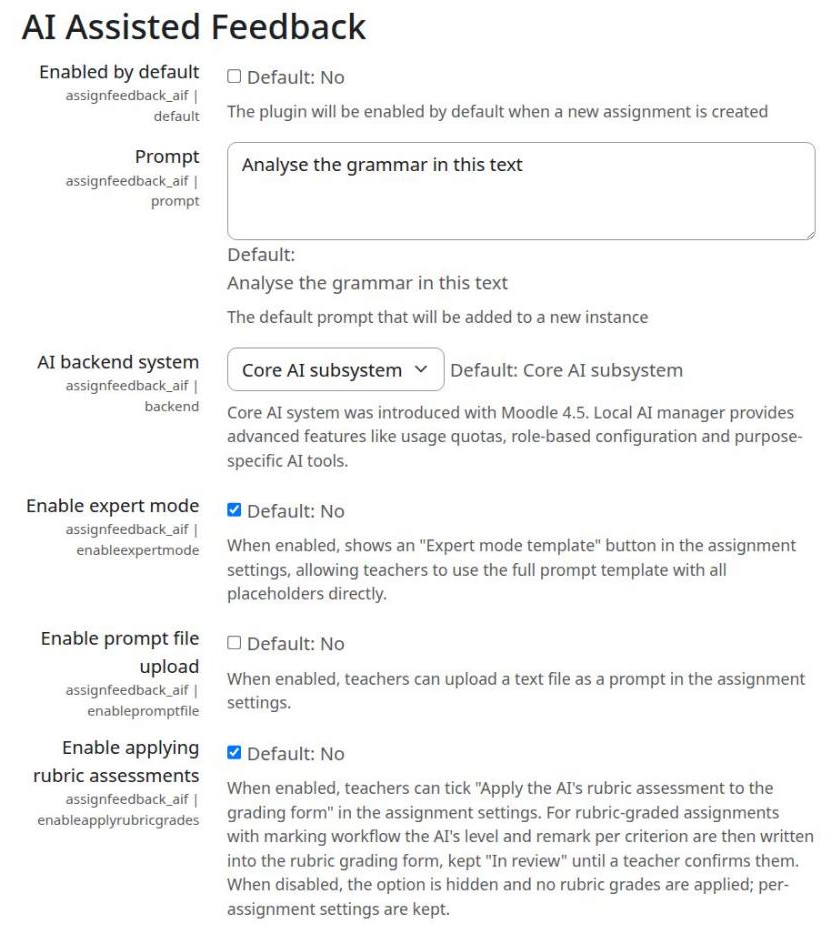

# AI Assisted Feedback (assignfeedback_aif)

An assignment feedback plugin that uses AI to generate feedback on student submissions. Feedback
can be generated automatically when a student submits, or by teachers for one or many students
from the grading interface. Teachers can review and edit the feedback before releasing it.

## Features

- **AI feedback** on online text, uploaded files (text is extracted) and images.
- **Rubric aware**: rubric criteria and levels are included in the prompt.
- **Apply rubric assessment (opt-in)**: with rubric grading and marking workflow, the AI's level
  and remark for each criterion are written into the rubric. The grade stays "In review" until
  a teacher releases it. See [Rubric grade application](docs/rubric-grade-application.md).
- **Automatic or manual generation**: on submission, in bulk from the grading table, or
  regenerated for a single student from the grading form.
- **Configurable prompt template** with placeholders for the submission, rubric, teacher
  instructions, assignment name and language.
- **AI disclaimer** appended to every response, optionally translated to the student's language.
- **Two AI backends**: the Moodle core AI subsystem, or
  [local_ai_manager](https://moodle.org/plugins/local_ai_manager) for quotas, role-based access
  and purpose-specific configuration.

## Requirements

- Moodle 5.0 or later, PHP 8.2 or later.
- [local_ai_content](https://moodle.org/plugins/local_ai_content), used for extracting text from
  submitted files.
- An AI backend: either an AI provider configured in *Site administration > AI > AI providers*,
  or local_ai_manager installed and configured.

## Installation

Install from the Moodle plugins directory, or copy the plugin to `mod/assign/feedback/aif` and
visit *Site administration > Notifications*.

## Configuration

Site settings are under *Site administration > Plugins > Activity modules > Assignment >
Feedback plugins > AI Assisted Feedback*. They include the AI backend, the default prompt, the
prompt template and the disclaimer.

In each assignment, enable **AI Assisted Feedback** under *Feedback types*, enter the prompt for
this assignment and optionally enable automatic generation on submission. Generation runs as an
ad-hoc task, so cron must be running.

## Privacy

The plugin stores the AI feedback for each submission attempt and supports the Privacy API for
export and deletion. To generate feedback, the submission, rubric and assignment details are sent
to the configured AI backend, which logs each request. Student names are not sent, but a
submission may contain personal data, so check your AI provider's data processing terms. See
[Privacy API](docs/api-reference.md#privacy-api-gdpr) for details.

## Documentation

More detail is in [docs/](docs/): [teacher guide](docs/teacher-guide.md),
[admin configuration](docs/admin-configuration.md),
[prompt templates](docs/prompt-template-system.md), [AI backends](docs/ai-backends.md) and the
[development guide](docs/development.md), which covers architecture and running the tests.

## Credits

- Original author: [Marcus Green](https://github.com/marcusgreen)
- A large amount of the code was contributed by [ByCS Lernplattform](https://github.com/bycs-lp)
  (ISB Bayern). They are based in Bavaria and look after approximatly 18 million Moodle accounts.
- Contributors: Sumaiya Javed (Catalyst), Thom Rawson (inspiration and support)

## License

[GNU GPL v3 or later](https://www.gnu.org/copyleft/gpl.html). See [LICENSE](LICENSE).

Source and issues: https://github.com/marcusgreen/moodle-assignfeedback_aif
